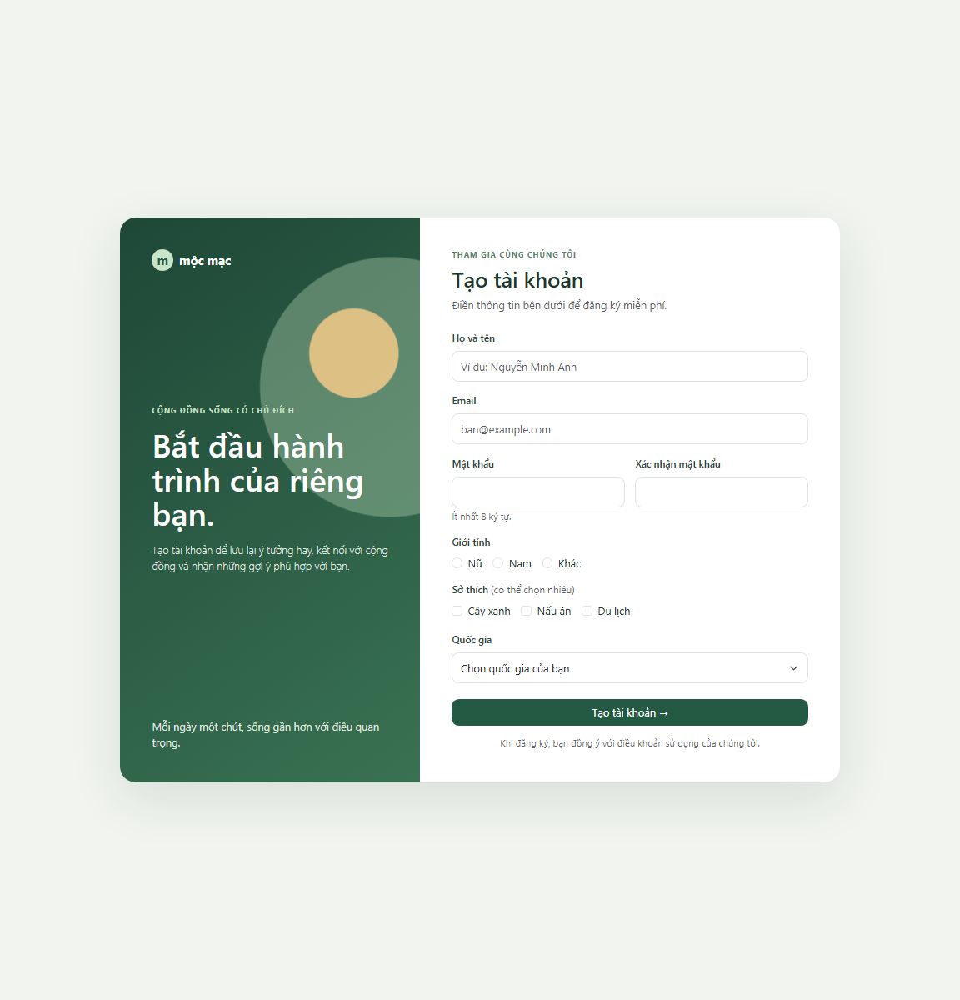

# Bootstrap Registration Form

A responsive Vietnamese registration form built with Bootstrap 5.3.3 form controls, radio buttons, checkboxes, a select menu, and a primary button. Browser-side validation checks required fields, email format, minimum password length, and matching passwords. Submission displays a demo confirmation; it does not send data to a server.

## Run

Open `index.html` with an internet connection so the Bootstrap stylesheet can load.

## Screenshots

### Desktop

### Mobile

